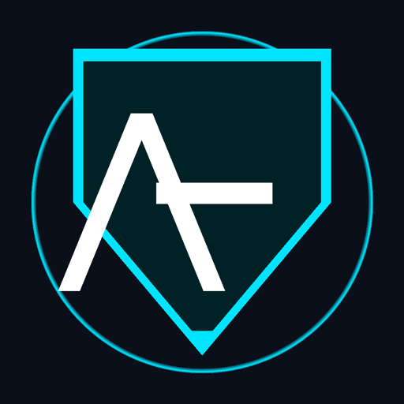

# Alvora Cyber

> AI security platform for macOS — protects your machine and your AI usage in real time. Monitors network connections, guards every prompt you send to AI tools, and keeps sensitive files encrypted on disk.



---

## What it does

| Feature | Description |
|---|---|
| **Network Monitor** | Watches every outbound connection in real time, flags unknown or suspicious destinations, and learns your normal baseline over time |
| **AI Threat Triage** | Runs an LLM over security events to explain what happened in plain English — works fully offline via Ollama |
| **Encrypted Vault** | AES-256-GCM file encryption with scrypt key derivation; your master password never touches disk |
| **Browser Extension** | Scans prompts before they reach any AI chatbot — catches PII leakage, prompt injection, and jailbreak attempts |
| **File Analyzer** | Checks downloaded files for suspicious signatures and unsigned binaries |
| **System Hardener** | Audits FileVault, firewall, sharing settings, and login items against security best practices |
| **Security Playbook** | Step-by-step remediation guides for every threat type the app detects |

---

## Requirements

- macOS (Apple Silicon recommended; Intel untested)
- Node.js 18+
- [Ollama](https://ollama.com) — optional, but enables fully offline AI (no API key needed)

---

## Run locally

```bash
# 1. Install dependencies
npm install
cd backend && npm install && cd ..

# 2. Copy the env template and fill in any keys you want
cp .env.example .env

# 3. Start backend + Vite dev server
npm run dev
# → backend on http://localhost:3001
# → UI on http://localhost:5173
```

To run as an Electron desktop app:

```bash
npm run dev:electron
```

---

## Browser extension

1. Open Chrome → `chrome://extensions`
2. Enable **Developer mode**
3. Click **Load unpacked** → select the `extension/` folder

The extension connects to the local backend automatically.

---

## AI providers

Alvora tries providers in order and falls back gracefully:

```
Fast tier:  Ollama (local) → NVIDIA NIM → Anthropic
Deep tier:  OpenRouter → NVIDIA NIM → Anthropic → Ollama
```

No API keys required — Ollama works offline and free. Add keys to `.env` to unlock cloud fallbacks.

---

## Build a distributable

```bash
npm run dist:mac    # notarized .dmg for macOS
npm run dist:win    # Windows installer
npm run dist:linux  # AppImage
```

---

## Project layout

```
backend/          Node.js API server — threat intel, vault, AI layer
extension/        Chrome extension — prompt scanner, link guard
src/              React UI (Electron renderer)
electron/         Electron main process
benchmark/        PII + injection detection accuracy eval suite
website/          alvoracyber.com (Cloudflare Pages / Vite)
```

---

## License

MIT
